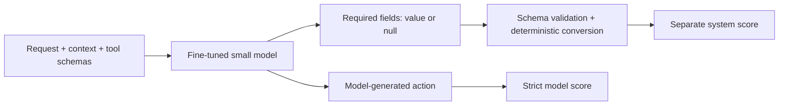
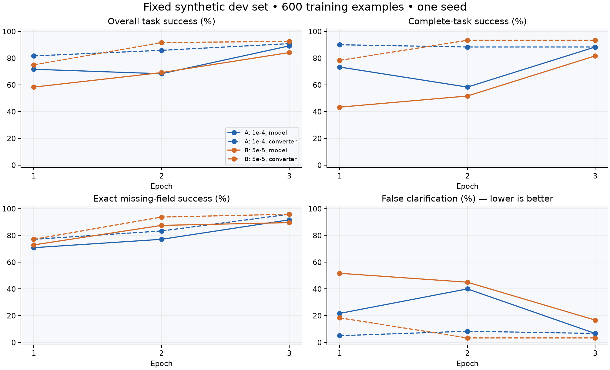
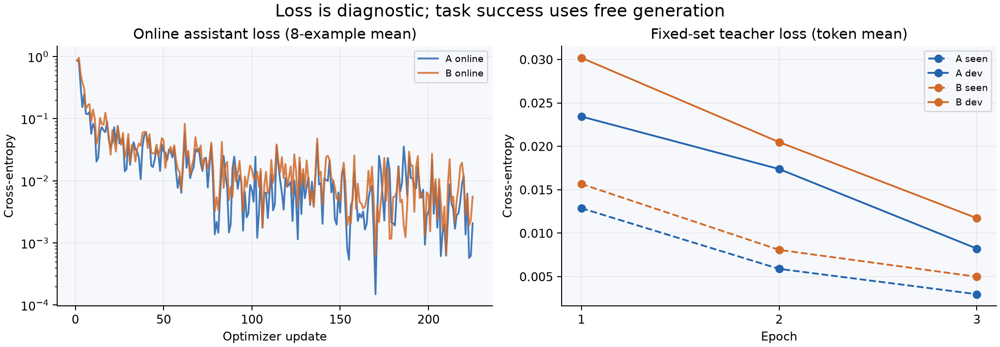

# Field-first tool calling

**Teach a small language model to identify what it knows before deciding whether to call a tool or ask for missing information.**

[中文说明](README.zh-CN.md) · [Results](docs/results.md) · [Reproduce](docs/reproduction.md) · [Dataset](docs/data.md)

This project studies a practical failure in tool-using assistants: a request omits a required argument, but the model fills it with a plausible value from an inventory. Fine-tuning can produce the opposite failure—asking for information already present. The goal is to improve missing-argument detection while preserving correct calls on complete requests.

Using **Qwen3-1.7B in 4-bit precision**, **600 synthetic training examples**, and **458,752 LoRA parameters**, field-first supervision reached **107/120 (89.2%)** strict task success after three epochs on a fixed development set. A separate system using the model's fields and a deterministic converter reached **111/120 (92.5%)** with the lower learning rate.

> These are development results from one seed on a repeatedly used synthetic benchmark. They are not held-out test results or evidence of broad real-world generalization. The model and converter scores are reported separately.

## How it works

The model sees a request, context and the current tool schemas. It produces two JSON objects:

```text
Request: Rank runs in project boreal by peak_return, descending.
```

```json
{"tool":"rank_runs","fields":{"project":"boreal","environment":null,"metric":"peak_return","order":"desc","limit":null}}
{"action":"clarify","missing_fields":["environment","limit"]}
```

Every required field must have a grounded value or `null`. The model then emits `call`, `clarify` or `unsupported`. We evaluate both its final action and a separate deterministic conversion of its predicted fields.



The converter receives **only the public schemas and predicted fields**. It cannot recover a missing value or read gold labels. Invalid fields remain failures in the denominator. No external tools are executed; task success is checked against deterministic synthetic fixtures.

## Main results

Same development set: **60 complete, 48 missing-argument and 12 unsupported requests**. Missing-argument success requires the **exact set** of missing fields. False clarification counts actual `clarify` actions on complete tasks; an invalid response is still a task failure.

| Method | Complete /60 ↑ | Missing /48 ↑ | False clarification /60 ↓ | Unsupported /12 ↑ | Total /120 ↑ |
|---|---:|---:|---:|---:|---:|
| Base model, internal field inspection, one JSON | 54 | 1 | 1 | 11 | 66 (55.0%) |
| Field-first, 1e-4, epoch 1 | 44 | 34 | 13 | 8 | 86 (71.7%) |
| Field-first, 1e-4, epoch 3 | 53 | 44 | 4 | 10 | **107 (89.2%)** |
| Field-first, 5e-5, epoch 3 | 49 | 43 | 10 | 9 | 101 (84.2%) |
| Fields + converter, 1e-4, epoch 3 | 53 | 46 | 4 | 10 | 109 (90.8%) |
| Fields + converter, 5e-5, epoch 3 | **56** | **46** | 2 | 9 | **111 (92.5%)** |

The base control uses the same cases and internal field-inspection instructions, but a one-object output protocol. Thus the base-to-fine-tuned comparison includes both training and output representation. The untrained two-object control and all intermediate checkpoints are included in [the full results](docs/results.md), including its format failures.



Three observations matter more than the headline:

- **More epochs helped, but progress was not monotonic.** At 1e-4, model success went 86 → 82 → 107; false clarification went 13 → 24 → 4.
- **Lower learning rate was not automatically better.** At epoch 3, 1e-4 had better model-only accuracy. The converter system differed by just two cases in favor of 5e-5; this does not establish statistical superiority.
- **Correct fields do not guarantee a correct generated action.** At 1e-4, correct-field/wrong-action cases fell from 13 to 2 after three epochs. This motivates evaluating extraction and action consistency separately.



## Re-score the published results on a CPU

Python 3.11+. No model download, GPU or private experiment folders are required.

```bash
git clone https://github.com/Llark2008/field-first-tool-calling.git
cd field-first-tool-calling
python3 -m venv "$HOME/.local/share/field-first-tool-calling/venv-cpu"
source "$HOME/.local/share/field-first-tool-calling/venv-cpu/bin/activate"
python -m pip install -r requirements-cpu.txt
python -B -m fieldfirst.verify
python -B -m fieldfirst.tests
```

Verification checks file hashes, target construction, split composition and prompt identity, then re-scores **1,680 raw generations**, comparing all **12 epoch × split cells** with the published metrics. CPU tests cover strict JSON parsing, scoring, conversion, data generation, training masks and release integrity; optional MLX tests are skipped unless explicitly enabled.

For training on Apple Silicon, see [reproduction instructions](docs/reproduction.md). Environments, model caches and checkpoints live **outside this repository**.

## What makes this a research project

- Paired complete/missing-information examples control the decision boundary; inventories are explicitly not defaults.
- Exact missing-field, false-clarification, premature-call, execution and format metrics expose failure modes hidden by aggregate accuracy.
- Assistant-only loss and explicit token boundaries prevent prompt tokens from dominating the objective.
- Controlled learning-rate/epoch comparisons retain the same 600 examples, order, target and optimizer settings.
- Model-generated actions, deterministic conversion and oracle-field diagnostics answer different questions and are kept separate.
- Raw predictions, frozen targets, source hashes, checkpoints' training recipe and CPU verification make the results inspectable.

The earlier sequence of prompting, data, optimizer and action-weighting experiments is described in [the research notes](docs/research-notes.md). Their original source modules are retained under `toolcall_lab/` and `experiments/`; historical orchestration scripts require archived local runs. The supported standalone entrypoints are under `fieldfirst/`.

## Scope and next steps

This is a local research prototype for synthetic, single-tool tasks, not a production agent. It has no new sealed test, multiple-seed estimate, real-user dataset, Windows/CUDA implementation or broad multi-step tool-use evaluation. The 120 seen-training cases are a fixed subset of the 600 training cases. A lower loss is not the same as a higher free-generation task accuracy.

Next useful experiments are a new untouched test set with paraphrases and schema changes, multiple seeds, and more varied paired examples. This experiment tested longer training and learning rate; **it did not test whether more data helps**.

Built with Python, MLX, Qwen3 and AI-assisted coding. Models and adapters are not distributed in this repository; upstream model terms apply separately. See [reproduction](docs/reproduction.md) for the pinned model revision and validation scope.
