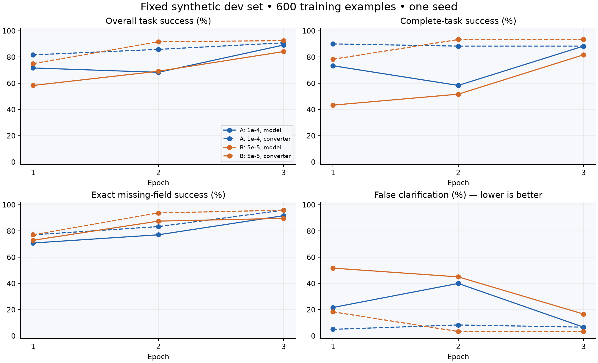
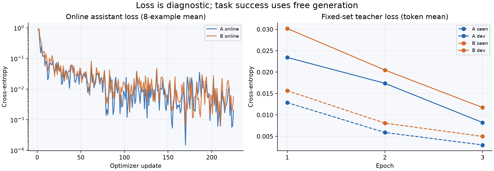

# 字段先行的工具调用可靠性

[English](README.md) · [完整结果](docs/results.md) · [复现步骤](docs/reproduction.md)

我们研究一个具体问题：小模型面对工具调用任务时，容易在缺少必要信息时擅自填参；直接训练它追问，又可能让它对信息完整的请求过度追问。

做法是让模型先输出每个必需字段的已知值或 `null`，再输出最终动作 JSON。我们分别评测模型自行生成的动作，以及由模型字段经过确定性规则转换得到的动作。转换器只读取工具 schema 和模型预测字段，不读取标准答案，也不会替模型补猜值。

在同一组反复使用的合成开发集上，Qwen3-1.7B 4-bit 使用 600 条数据、458,752 个 LoRA 参数训练三轮，模型独立输出最高达到 **107/120（89.2%）**；字段加转换器的系统最高达到 **111/120（92.5%）**。这是单个种子的开发集结果，不能当作独立测试集成绩。

| 方法 | 完整任务 /60 | 缺参精确识别 /48 | 误追问 /60 ↓ | 不支持 /12 | 总正确 /120 |
|---|---:|---:|---:|---:|---:|
| 未微调，内部字段检查、单 JSON | 54 | 1 | 1 | 11 | 66 |
| 1e-4，一轮，模型独立输出 | 44 | 34 | 13 | 8 | 86 |
| 1e-4，三轮，模型独立输出 | 53 | 44 | 4 | 10 | 107 |
| 5e-5，三轮，模型独立输出 | 49 | 43 | 10 | 9 | 101 |
| 1e-4，三轮，字段加转换器 | 53 | 46 | 4 | 10 | 109 |
| 5e-5，三轮，字段加转换器 | 56 | 46 | 2 | 9 | 111 |

基线和微调模型的输出格式不同，因此相对基线的提升同时包含训练与表示方式的变化。未训练的双 JSON 对照及全部中间轮次都在[完整结果](docs/results.md)里。

可以观察到：

- 增加训练轮数有帮助，但过程不单调。1e-4 的总正确数是 86 → 82 → 107，误追问是 13 → 24 → 4。
- 学习率更低不一定更好。三轮后 1e-4 的独立输出更好；5e-5 加转换器只多对两题，不能据此断言显著优于另一组。
- 字段正确之后，模型仍可能生成不一致的动作。1e-4 组这类错误由 13 例降到 2 例，说明继续训练能改善一致性，但没有完全消除。
- 总分提高主要来自缺参识别。模型独立输出的完整任务 54 → 53，不能说所有指标都超过基线。

普通 CPU 就可以重新计算发布结果：按英文 README 建立仓库外的 Python 环境后，运行 `python -B -m fieldfirst.verify`。它会核验数据与预测文件，重新评分 1,680 条原始生成，并逐项比对 12 组训练结果。`python -B -m fieldfirst.tests` 运行测试。

仓库提供原始合成数据、实际生成、对照指标、失败案例、曲线、评分代码和独立训练入口。环境、模型、优化器和检查点均放在仓库外。完整训练仅在 Apple Silicon/MLX 上验证过；本次发布新增入口只做短程训练、保存重载与评测检查，没有重新跑完整三轮。

后续优先做新的未使用测试集、更多随机种子和更丰富的配对表达，检验泛化是否成立。本轮没有增加数据量，因此还不能回答“更多数据是否会继续提升”。
